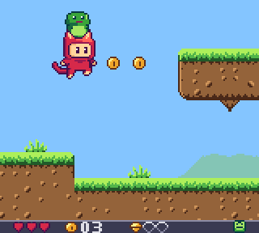
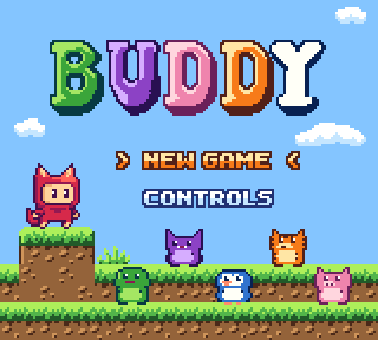
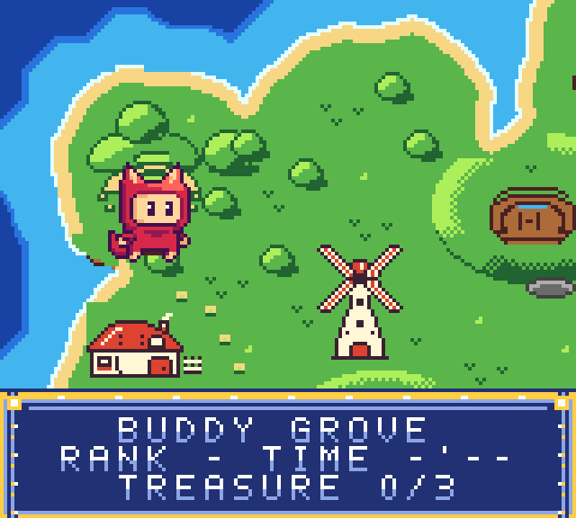
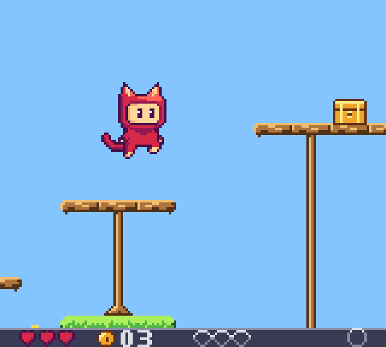
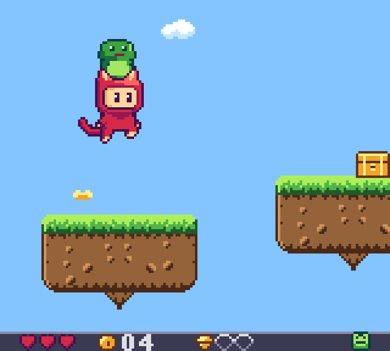
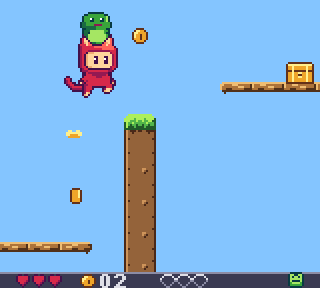
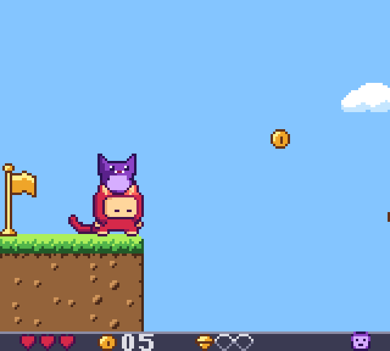

# BUDDY

A Game Boy Color platformer about carrying, throwing and warping to creature buddies.

**[Play it in your browser](https://mitchivin.github.io/game-boy-color/)**

## The game

You play a cat in a hood. You can carry one buddy at a time. Each buddy changes how you move, can be thrown through a gap, and becomes a place you can warp back to.

| Buddy | Ability |
| --- | --- |
| Hopper, frog | A in the air gives a second jump |
| Glidey, bat | Hold A while falling to glide, or ride the wind columns up |
| Digby, pig | Down + B digs through soft dirt to buried treasure |
| Ember, tiger | Tap B to dash through cracked blocks and burn brambles |
| Bubbo, penguin | A swims up through the flooded grotto |

The campaign runs from an island map through Meadow Path, Windmill Hills, Tidepools, Root Cellar, Ember Ridge and Sky Ruins to a boss fight with The Collector, then the ending and credits. Buddy Grove is a practice stage with all five buddies. Progress saves to cartridge RAM, like a real cartridge.

## Screenshots

  
  

  
  

  
  

## Controls

| Button | Action |
| --- | --- |
| D-pad | Move. Down crouches. Up uses a nearby exit |
| A | Jump. Hold for height |
| B | Hold, then release to throw the buddy you carry. With no buddy carried, B warps to the one you threw or dropped |
| Select | Drop the carried buddy |
| Start | Pause |

The CONTROLS page on the title screen shows all of this with pictures.

## Play

BUDDY comes with the [Game Boy Color browser emulator and Windows desktop widget](https://github.com/mitchivin/game-boy-color). Open the [live demo](https://mitchivin.github.io/game-boy-color/) and start BUDDY.

This repository contains public product information only. The game's source is not published here.

## Credits

A game by Mitch Ivin. Music and sound effects are original. The hero's motion is based on Pink Man from [Pixel Adventure](https://pixelfrog-assets.itch.io/pixel-adventure-1) by Pixel Frog (CC0).

## Related

- [Game Boy Color](https://github.com/mitchivin/game-boy-color)
- [Game Boy](https://github.com/mitchivin/game-boy)
- [DoodleDev](https://github.com/mitchivin/doodledev)
- [iPod Classic](https://github.com/mitchivin/ipod-classic)
- [MitchIvin XP](https://mitchivin.com/)
